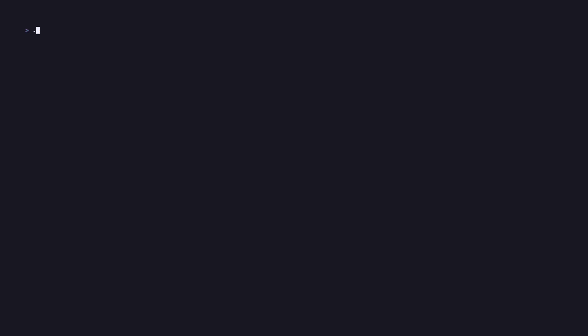

# Lazylab

[](https://github.com/GF6599/lazylab/actions/workflows/ci.yml)
[](LICENSE)

Lazylab is a keyboard-driven terminal UI for GitLab. It shows your projects, pipelines, jobs and merge requests, and it acts on them without a browser.



## Install

Lazylab runs on macOS and Linux.

### Homebrew

```bash
brew install GF6599/tap/lazylab
```

Earlier releases came as a Homebrew cask. If you installed the cask, remove it before you install the formula:

```bash
brew uninstall --cask lazylab
```

### Release archive

The [releases page](https://github.com/GF6599/lazylab/releases) has one archive for each platform:

- `lazylab-aarch64-apple-darwin.tar.xz`
- `lazylab-x86_64-apple-darwin.tar.xz`
- `lazylab-aarch64-unknown-linux-musl.tar.xz`
- `lazylab-x86_64-unknown-linux-musl.tar.xz`

The Linux binaries are static musl builds, so they need no system libraries. Each archive has a `.sha256` file beside it, and `sha256.sum` holds the checksums of all of them. Unpack the archive and put the `lazylab` binary in a folder on your `PATH`.

### From source

You need [rustup](https://rustup.rs). `rust-toolchain.toml` sets the Rust version, and rustup installs that version on the first build.

```bash
git clone https://github.com/GF6599/lazylab.git
cd lazylab
cargo install --locked --path .
```

Cargo puts the binary in `~/.cargo/bin`.

Run `lazylab --version` to see which version you have.

## Usage

Lazylab needs a GitLab personal access token with the `api` scope, or a `glab` that is logged in.

```bash
export GITLAB_TOKEN=glpat-xxxx
lazylab --host https://gitlab.example.com
```

Without `--host`, lazylab connects to `https://gitlab.com`. You can also put the token and the host in a config file. When no token is set, lazylab asks [`glab`](https://gitlab.com/gitlab-org/cli) for the token that `glab auth login` stored. With no host set, it also takes the host of `glab`. With a host set, it takes only a token that `glab` stored for that host.

To try lazylab with sample data and no GitLab, run:

```bash
lazylab --demo
```

### Screen

Lazylab has four panes: projects, pipelines, jobs and merge requests. A sidebar lists the items of the pane, and the detail pane shows the selected item. At 100 columns or more, the two are side by side. In a narrower terminal, lazylab shows one of them at a time. The terminal must be at least 40 columns by 10 rows.

Press `?` to see every key. The main keys are:

| Key | Action |
|---|---|
| `j` `k` `↑` `↓` | Move |
| `g` `G` | First, last |
| `ctrl+d` `ctrl+u` | Page down, up |
| `1` to `4`, `tab` | Choose a pane |
| `l` `enter` | Open the detail pane |
| `h` `esc` | Back |
| `z` | Full screen for the pane in view |
| `?` | Open or close the help |
| `q` `ctrl+c` | Quit |

### Projects

The projects pane has two tabs, `★ favorites` and `all`. Lazylab opens on the favorites tab when you have favorites. The glyph before each project is the status of its latest pipeline.

| Key | Action |
|---|---|
| `t` `T` | Change between the favorites tab and the all tab |
| `f` | Add the project to the favorites, or remove it |
| `{` `}` | Move a favorite up, down |
| `/` | Search the projects |
| `ctrl+r` | Load the projects again from GitLab |

### Pipelines and jobs

The jobs pane shows the jobs of the selected pipeline. The detail pane of a job shows its log. Lazylab loads the pipelines and the jobs in view again every 5 seconds.

| Key | Action |
|---|---|
| `[` `]` | The page of pipelines before, after |
| `T` | The test report of the pipeline, or its stages |
| `N` | Run a pipeline, with a ref and variables |
| `P` | Play a manual job, with variables |
| `R` | Retry the pipeline or the job, after a question |
| `C` | Cancel the pipeline or the job, after a question |

### Merge requests

The detail pane of a merge request has three tabs: info, threads and diff.

| Key | Action |
|---|---|
| `t` `T` | The next, previous state: opened, merged, closed |
| `[` `]` | The tab before, after |
| `r` | Resolve or reopen the thread |
| `c` | Start a thread, reply to a thread, or comment on the diff line |
| `N` | Open a merge request, with a branch search |

### Copy a glab command or an address

Lazylab does not have its own scripting commands. It gives you the [`glab`](https://gitlab.com/gitlab-org/cli) command for the selected project, pipeline, job or merge request.

| Key | Action |
|---|---|
| `y` | Copy the main `glab` command of the item |
| `Y` | Open a menu of all `glab` commands of the item, and copy one |
| `ctrl+o` | Copy the web address of the item |

Each command names its project with `-R`, so it works from any folder. For a host other than gitlab.com, `-R` gets the full address of the project. To copy, lazylab sends the text to the terminal with OSC 52. Your terminal must support OSC 52. The copy also works over SSH. You need `glab` only to run a command, not to copy it.

### Browse the files

Press `e` to browse the files of the item in a file explorer. Lazylab makes a shallow `git` checkout of the ref, then gives the terminal to the explorer. A commit that is already checked out opens at once, with no fetch. A branch is fetched each time, because it can move. Quit the explorer to go back to lazylab.

- On a project, the ref is the default branch.
- On a pipeline or a job, the ref is the commit that the pipeline built.
- On a merge request, the ref is the source branch.

The explorer is [yazi](https://yazi-rs.github.io) by default. Set another one with `--explorer` or with `explorer` in the config file. Give a program name on your `PATH` or an absolute path. Lazylab refuses a relative path. The explorer gets two environment variables: `LAZYLAB_PROJECT_URL`, the web address of the project, and `LAZYLAB_REF`, the branch or commit of the checkout. A key binding of the explorer can use them to make the GitLab address of a file.

`e` needs `git` on your `PATH`. The token goes to `git` only in its environment, never in an argument or a file. The demo has no files to browse.

## Configuration

| Flag | Environment variable | Config file key | Default |
|---|---|---|---|
| `--host` | `GITLAB_HOST` | `host` | `https://gitlab.com` |
| `--token` | `GITLAB_TOKEN` | `token` | none |
| `--projects-per-page` | `GITLAB_PROJECTS_PER_PAGE` | `projects-per-page` | `30`, at most `100` |
| `--log-level` | `GITLAB_LOG_LEVEL` | `log-level` | `error` |
| `--explorer` | none | `explorer` | `yazi` |
| `--demo` | `GITLAB_DEMO` | `demo` | off |
| `--config` | `LAZYLAB_CONFIG` | none | none |

The log level is one of `debug`, `info`, `warn` or `error`. Lazylab also reads the config file path from `GITLAB_TUI_CONFIG` when `--config` and `LAZYLAB_CONFIG` are not set.

Precedence, highest first:

1. Flags
2. Environment variables
3. The config file
4. The credentials of `glab`, for the token and the host only
5. Defaults

Do not use `--token`. Every local user can see a command-line argument in the process list, and your shell writes it to the history file. Use `GITLAB_TOKEN`, a config file, or `glab auth login`.

A config file is optional. Lazylab reads TOML (`.toml`) and JSON (`.json`), and it chooses the format from the file extension. It refuses every other type, YAML included.

```toml
host = "https://gitlab.example.com"
projects-per-page = 50
explorer = "lf"
```

### Files

Lazylab keeps its files in one folder. When lazylab creates the folder, only your user can open it.

- macOS: `~/Library/Caches/lazylab`
- Linux: `$XDG_CACHE_HOME/lazylab`, or `~/.cache/lazylab` when `XDG_CACHE_HOME` is not set

The folder holds:

- `projects_<host>.json`: the project list. When this file is less than one day old, a start shows the list from it. Otherwise, lazylab loads the list from GitLab. Press `ctrl+r` to load the list from GitLab at any time.
- `favorites_<host>.json`: your favorites and their order.
- `lazylab.log`: the log of the last session. Each start empties it. Lazylab removes tokens from each line. With `--log-level debug`, the log has a line for each GitLab request, with its status and duration.
- `checkouts/<host>/<project>/<ref>`: the checkouts that `e` makes. The next `e` on the same project and ref uses the checkout again. Delete the folder to free the space.

`<host>` is the scheme and the host name, for example `https_gitlab_com`.

## Development

The `justfile` has the development commands. Run `just --list` to see all of them.

```bash
just test                            # cargo test
just lint                            # rustfmt check, clippy, and the RustSec advisory scan
just run https://gitlab.example.com  # run against a host, with GITLAB_TOKEN from the environment or .env
just demo                            # build a release binary and record doc/demo.gif with vhs
just release-dry-run                 # build the release archive and the Homebrew formula, and publish nothing
```

`just lint` needs [cargo-deny](https://github.com/EmbarkStudios/cargo-deny) and a network connection. `just demo` needs [vhs](https://github.com/charmbracelet/vhs). `just release-dry-run` needs [dist](https://github.com/axodotdev/cargo-dist).

## License

[MIT](LICENSE)
